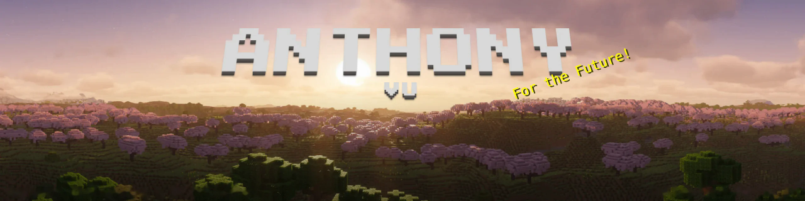

  

  &nbsp;

## About Me

Hi, I'm **Anthony**! I'm a **Software Engineering** student at **UT Arlington**, based in Arlington, TX, and currently a **software engineering intern**.

I enjoy working across the whole stack: low-level C and operating systems work, full-stack and mobile apps, and Minecraft mods used by real players.

I try to live by the line "For the Future" meaning I do my best work I can today so the developers who come after me can thank the past instead of cursing it.

## Currently Crafting

- **[Mavigator](https://github.com/AntoVu/cse3311-fall26-group7)**, a precise UT Arlington campus map app, built with a team in React Native + TypeScript
- **[AntoOdin](https://github.com/AntoVu/AntoOdin)**, my quality-of-life addon for the OdinFabric Minecraft mod
- My software engineering internship

## Inventory (tech stack)

  

<b>Also:</b> SQL · JUnit · ARMv7 Assembly · React Native · REST APIs · UML

## Projects

| Project | What it does | Built with |
| --- | --- | --- |
| **[Mavigator](https://github.com/AntoVu/cse3311-fall26-group7)** | Campus map for UT Arlington with a pan/zoom building map, a live class schedule, and parking lots colored by permit and time of day. Team project, built in iterations. | TypeScript, React Native (Expo) |
| **[AntoOdin](https://github.com/AntoVu/AntoOdin)** | Quality of life addons for the Odin Minecraft mod: wardrobe hotkeys and queueing, a CPS display, auto-refill, and auto-warp helpers. | Kotlin |
| **Antour Addons** | All in one Hypixel Skyblock mod with 60+ independently configurable features and full documentation, maintained for 20 months. | JavaScript |
| **Everett Splits** | First of its kind run-time prediction module for a speedrunning client that adapts its estimate as each segment is completed. | JavaScript |
| **Exotic Scanner** | Scans a server's player list, pulls each player's inventory from a public REST API, and flags rare "exotic" items in real time. | Kotlin, Java, REST |
| **[Unix Shell](https://github.com/AntoVu/cse-related/tree/main/CSE3320/lab3)** | Interactive Unix-style shell built on low-level POSIX system calls. | C, POSIX, ncurses |
| **[Disk File Simulation](https://github.com/AntoVu/cse-related/tree/main/CSE3320/lab2)** | Simulates a disk storage device inside a single file, using pointers to separate storage regions. | Go |
| **[Encryption Server](https://github.com/AntoVu/cse-related/tree/main/CSE3320/lab4)** | Web server that AES-encrypts files on upload and decrypts them on download. | Python |
| **Ultrasonic Burglary Alarm** | Embedded security system that detects motion with ultrasonic pulse timing and sounds an alarm. | C, Raspberry Pi 3 |

## Advancements (honors)

| | Advancement | Description |
| --- | --- | --- |
| 💎 | **Cover Me with Diamonds** | 4.0 GPA in Software Engineering at UT Arlington |
| ⭐ | **Diamonds!** | President's List (perfect 4.0 term): Fall 2025, Spring 2026 |
| 📘 | **Acquire Hardware** | Dean's List for four straight semesters, Fall 2024 to Spring 2026 |
| 🎓 | **The End?** | High school valedictorian, Class of 2024 (107.0 weighted GPA, 1st of 420) |

## Statistics

  <i>"It ain't much, but it's honest work." - David Brandt</i>

  

  Writing the best code I can in the present, so the future can thank the past.

